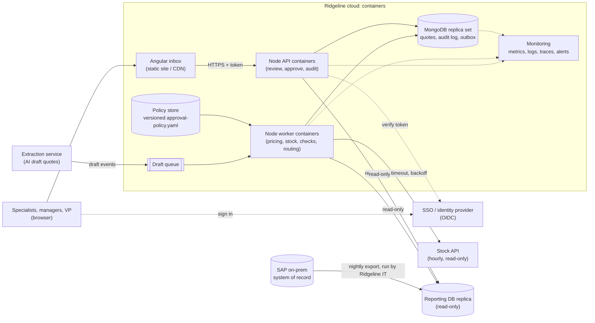

# Ridgeline Quote Approvals

This service takes AI-generated draft quotes and applies contract pricing and stock checks. It then routes each quote for approval, so it reaches the right person sooner. **A person approves every quote.** A quote specialist signs off on each one. A regional manager or the VP of Sales also approves when the discount or value requires it. The service only reads from Ridgeline's systems and never writes to SAP.

Stack: Node 24 + TypeScript (Express 5, zod, decimal.js, MongoDB driver) in `backend/`, Angular 22 in `frontend/`, MongoDB for quotes and the audit log.

## Repository

https://github.com/BhaskarCharan/ridgeline-quote-approvals

```
backend/                    API, batch CLI, pricing / stock / routing services, tests
  config/approval-policy.yaml   approval rules (data, not code)
  src/domain/               models, workflow table, policy schema, typed errors
  src/ports/                interfaces: Clock, ReferenceData, StockProvider, repositories
  src/adapters/             CSV reporting data, HTTP stock client, Mongo + in-memory stores
  src/services/             pricing, review checks, routing, duplicates, processor, review, audit
  src/api/                  Express app, X-User-Id auth, routes, single error handler
frontend/                   Angular review inbox (one page)
data-pack_platform/         sample data from Ridgeline (read-only, never modified)
outputs/routing_results.json    result of processing the 10 sample drafts
.chat-history/              AI assistant log
.env.example                configuration variable names (no values)
```

## How to Run

You need Node 24, Python 3.9+ for the stock API mock, and MongoDB 7+ running locally as a standalone instance.

**1. Node version and dependencies**

```bash
nvm use                       # reads .nvmrc -> Node 24
(cd backend && npm install)
(cd frontend && npm install)
```

**2. MongoDB** on `mongodb://127.0.0.1:27017` (use either option)

```bash
brew services start mongodb-community                          # Homebrew install, or:
docker run -d --name ridgeline-mongo -p 27017:27017 mongo:7    # Docker
```

To run without MongoDB, set `PERSISTENCE=memory` on any backend command. Data is then lost when the process exits.

**3. Stock API mock** on port 8080. It fails 10% of requests with a 503 by default, which exercises the retries.

```bash
cd data-pack_platform && python3 mock_stock_api.py
```

Prefix the command with `MOCK_FAILURE_RATE=0` to turn the simulated failures off.

**4. API** on http://localhost:3000

```bash
cd backend && npm run dev
```

**5. Process the sample drafts.** This writes `outputs/routing_results.json` and stores quotes and audit entries in MongoDB.

```bash
cd backend
APP_NOW=2026-10-12T09:30:00-05:00 npm run process -- --reset
```

- `APP_NOW` freezes "now" at the policy's reference time (Mon 12 Oct 2026, 09:30 Central). Outside production it defaults to that value, so it can be omitted locally.
- `--reset` wipes quotes and the audit log first. It is for demos only and is refused when `NODE_ENV=production`.
- Re-running without `--reset` is safe: drafts that were already processed are skipped.
- Drafts can also be sent over HTTP: `POST /drafts/process` with `{ "drafts": [...] }` and an `X-User-Id` header.

**6. Tests and type check.** The tests need no network and no MongoDB. The Mongo adapter tests run only if a local MongoDB is reachable and skip otherwise.

```bash
cd backend
npm test             # vitest: approval tiers, $25k rule, backup approver, duplicates, API 401/403/409, ...
npm run typecheck    # tsc --noEmit, strict
```

**7. Angular inbox** on http://localhost:4200. It calls the API at `http://localhost:3000`.

```bash
cd frontend && npm start
```

Pick a user in "Acting as". The choice is sent as `X-User-Id`. Then approve or reject. API errors (401/403/409) appear in the message bar.

**Trying the API with curl**

```bash
curl -s -H "X-User-Id: S01" localhost:3000/quotes?status=pending_specialist
curl -s -X POST -H "X-User-Id: S01" localhost:3000/quotes/DQ-24101/approve   # 403: S01 prepared it
curl -s -X POST -H "X-User-Id: S02" localhost:3000/quotes/DQ-24101/approve   # approved (specialist only)
curl -s -X POST -H "X-User-Id: S01" localhost:3000/quotes/DQ-24106/approve   # -> pending_approver
curl -s -X POST -H "X-User-Id: U04" localhost:3000/quotes/DQ-24106/approve   # approved by the backup for U02
curl -s -H "X-User-Id: U04" localhost:3000/quotes/DQ-24106/audit
```

Endpoints:
- `GET /health`
- `GET /quotes?status=&approverId=`
- `GET /quotes/:id`
- `GET /quotes/:id/audit`
- `POST /quotes/:id/approve` with body `{version?, comment?}`
- `POST /quotes/:id/reject` with body `{reason, version?}`
- `PATCH /quotes/:id` (stubbed, returns 501)
- `POST /drafts/process`

**Configuration** comes from environment variables, which are validated with zod at startup. Every variable has a local default, so nothing needs to be set to run locally. `.env.example` lists the names. The service does not load `.env` files, so export variables in your shell.

## Approach

**Pipeline for each draft** (`QuoteProcessor`):

1. Duplicate check.
2. Pricing.
3. Stock lookup.
4. Review checks.
5. Approval tier.
6. Approver, with backups applied.
7. Save the quote and write an audit entry.

**Pricing** (`PricingService`, approval_rules.md rules 3 to 6):
- **Prices come only from the reporting database.** The service uses the customer's contract price if it is valid today, otherwise the list price. Both start and end dates are inclusive, and "today" is the calendar date in Central time.
- **An expired contract** falls back to the list price and flags the line, for example *"contract price expired 2025-12-31; list price used"*.
- **The draft's proposed discount** is applied on top of the contract or list price.
- **All money uses `decimal.js`.** Each line total is rounded half-up to cents, then the lines are summed.
- **Effective discount** = 1 − net total ÷ total at list price.
- **An unknown part or customer is flagged, never guessed.** An unknown part stays on the quote unpriced. An unknown customer falls back to list prices.

**Stock**: one call per quote to the batch endpoint, with up to 50 parts per call (see Reliability).

**Review checks**: one class per rule behind a `ReviewCheck` interface. Each check adds a flag for the specialist and never blocks the quote.

| Check | What it flags |
|---|---|
| Low confidence | Extraction confidence below 0.85 |
| Out of stock | Zero units in all warehouses |
| Unknown part | Part not found in the stock API |
| Stale stock | Stock reading older than 24h |
| Stock unavailable | Stock API still failing after retries |
| Stale export | Reporting export older than 36h |

**Routing:**
- **Tiers** are evaluated top to bottom, and the first match wins:
  - `vp_sales`: effective discount over 25%.
  - `regional_manager`: over 15%, or net total of $25,000 or more.
  - `specialist_only`: everything else (the catch-all).
- **Comparisons use the unrounded discount.**
- **Approver.** The regional manager is chosen by the customer's region. If that person is out of office today, the quote goes to their `backup_approver_id`, and the chain is followed as far as needed. If the chain loops or dead-ends, the quote gets a flag instead of hanging.

**Where the rules live:** `backend/config/approval-policy.yaml` holds the tiers and all thresholds. The file is validated with zod when the service starts: unknown keys, a missing catch-all tier or duplicate tier names stop startup. Nothing in the code hard-codes a threshold.

**Workflow:**
- **Transitions.** The allowed moves are in one table, `src/domain/workflow.ts`: `pending_specialist` → `pending_approver` (or `approved` when specialist-only) → `approved`, and either step can → `rejected`. `approved`, `rejected` and `duplicate` are final.
- **Who may act:** at step 1, any quote specialist except the one who prepared the quote; at step 2, only the routed approver.
- **Audit:** every action is written to an append-only log: who, what, when, status before and after, and field changes.

**Results on the sample drafts:**

| Outcome | Drafts |
|---|---|
| Specialist only | DQ-24101, DQ-24105, DQ-24108 |
| Regional manager | DQ-24102 → U01, DQ-24107 → U01, DQ-24106 and DQ-24109 → U04 (backup for U02, who is out of office) |
| VP | DQ-24103 and DQ-24104 → U05 |
| Duplicate | DQ-24110, a duplicate of DQ-24102 |

**What was stubbed:**

| Stub | Why | Production version |
|---|---|---|
| `X-User-Id` header auth, checked against `approvers.csv` | Enough to show the role checks | SSO (OIDC). Identity and role come from verified token claims |
| `PATCH /quotes/:id` returns 501 and describes the design | Out of scope | An edit re-runs the whole pipeline (pricing, stock, checks, tier, approver), resets the quote to `pending_specialist` so earlier sign-offs no longer count, and audits each changed field before and after |
| Reporting DB is the CSV export, loaded into memory at startup and checked row by row | Matches the data pack | Read-only replica of the reporting DB, reloaded after each nightly export |
| Stock API is `mock_stock_api.py` | Provided mock | Ridgeline IT's hourly stock API, through the same retry client |
| Intake is a JSON file (CLI) or `POST /drafts/process` | No queue needed for 10 drafts | The extraction service publishes to a queue that workers consume |
| Single MongoDB instance, no transactions | Simple local setup | Replica set, plus an outbox so each quote and its audit entry are written together |
| No notifications or reminders | Out of scope | Notify the routed approver; escalate when nobody acts within the SLA |

**The one decision that matters most: route on the effective discount computed from reporting-DB prices, not on the discount the draft proposes.** The proposed discount is applied on top of contract prices that are often already below list. Routing on the proposed number would send these quotes to the wrong approver:

- **DQ-24103** proposes 22%. That is regional-manager level, but its effective discount is **26.22%**, so it needs the **VP**.
- **DQ-24107** proposes 12%. That looks specialist-only, but its effective discount is **15.38%**, so it needs a **regional manager**.

Using reporting-DB prices also means the routed number always matches a price that a person can trace back to Ridgeline's own data.

## Reliability

**Stock API** (`HttpStockClient`):
- **Timeout:** each attempt has a 2s timeout via `AbortSignal.timeout`.
- **Attempts:** 3, using exponential backoff with jitter starting at a 200ms step.
- **Retry hint:** the API's `retry_after_seconds` is honoured, capped at 5s.
- **What is retried:** only 503s, timeouts and network errors. A 400, 404 or malformed response is not retried, since retrying cannot fix it.
- **Logging:** every retry is logged.
- **When attempts run out,** the client returns a failure result instead of throwing. The quote is still priced and routed, and gets the flag *"stock unavailable after retries"*. It is never blocked, and stock is never guessed.

**Stale or missing data** always becomes a flag for the specialist, never an error. The flags cover:

| Data problem | Flagged as |
|---|---|
| Stock reading older than 24h | Each affected line |
| Part unknown to the stock API | Each affected line |
| Part out of stock everywhere | Each affected line |
| Reporting export older than 36h | The whole quote |
| Expired contract | Each affected line |
| Unknown part or customer | The line or the whole quote |

For example, RL107944 has a stock reading 49.5h old, which flags DQ-24104 line 1 and DQ-24109 line 6.

The sample export is 31.5h old at the reference time, which is under 36h, so it is deliberately not flagged.

**Duplicates:**
- **Rule:** a draft is a duplicate if it has the same `rfq_id` and the same lines (part number and quantity, in any order) as a stored draft created within the policy window (24h).
- **When it is checked:** before pricing, so a duplicate costs no stock call.
- **What happens:** it is stored with status `duplicate` and `duplicate_of` the original, with null totals and approver. No approval request is created, and it is audited.
- **Across runs:** originals are looked up in the database, so a resubmission is caught even in a later run.

**Idempotency and lost quotes:** the quote's ID is the draft ID, with a unique index. Processing the same draft again does nothing and returns the stored quote. It is safe under concurrency: when 8 inserts of the same draft run at once, exactly one wins.

**Double approvals:** every decision is saved only if the quote's version and status are still the ones the reviewer saw. The update is a single atomic Mongo write, which works without transactions. Two cases return **409**:
- **Stale screen:** the client sends the `version` it is looking at, and the quote has moved on since.
- **Lost race:** two reviewers act at once. The tests check that exactly one wins.

The audit entry is written after the quote. A crash between the two writes could lose one audit line but never the quote. The production fix is the outbox listed under stubs.

**Roles:**
- **Who may act:** at step 1, any `quote_specialist` except `preparedBy`, so nobody approves their own work. At step 2, only the routed `approver_id`, with backups already applied. Anyone else gets **403**.
- **Unknown caller:** a missing or unknown `X-User-Id` gets **401**.
- **Error format:** every error response has the shape `{code, message, details}`.
- **Production:** SSO, with roles from identity-provider groups. The database user can only insert and read the audit collection.

## Production



**1. Deployment, and connecting without writing to SAP**
- **What runs where:**
  - The API and the workers are stateless containers on Ridgeline's container platform, and scale separately.
  - The Angular app is a static site.
  - MongoDB runs as a replica set (managed, or 3 nodes). That allows transactions, or an outbox, so a quote and its audit entry are saved together.
- **Ridgeline systems are read-only to us.** We read the reporting replica with a read-only database user, and the stock API is GET-only.
- **There is no connection from this service to SAP.** Data only flows from SAP to us, through the nightly export Ridgeline IT already runs. A network policy blocks traffic from our containers to SAP.
- **Approved quotes** go to the specialist to send. Order entry in SAP stays the existing manual step until a write to SAP is approved.
- **Drafts** arrive on a queue. Retries and redelivery are safe, because processing the same draft ID twice does nothing.

**2. What to monitor**
- **Time from draft to approval:** median and 90th percentile by tier, region and approver. This uses the draft's `created_at` and the `decisions[].at` timestamps already stored. Also track how long each step waits, and what share of quotes were approved within a target time. Today, about 30% of quotes wait 4 to 6 hours for a manager.
- **Queue health:** queue age, the number of pending quotes per approver, and how often backup routing is used.
- **Data health:** the stock API error and retry rate, how many quotes hit "stock unavailable", the age of the reporting export (alert above 36h), and the stale-stock rate.
- **Routing mix:** the share of specialist-only, manager and VP quotes, flag rates by type, and the duplicate rate.
- **Errors:** 401, 403 and 409 rates, 5xx responses, and failed audit writes.

**3. Changing approval rules without a code release**
- **Rules are data.** `approval-policy.yaml` lives in a versioned policy store: a Git-backed config repo with sales-ops review, or a small admin page. Workers reload it on publish.
- **Bad policies are rejected.** The zod schema refuses an invalid policy, so the last valid version stays in force.
- **Every quote records the `policyVersion` that routed it,** so past decisions can still be explained.
- **Preview before publishing.** Replay the last few weeks of drafts against the new policy and show how routing would change.

**4. With two more weeks**
- **Sign-in and editing:** real SSO, and the quote edit flow (reprice, reroute and audit).
- **Reliable writes and reminders:** an outbox, so the quote and its audit entry are written together, plus notifications to approvers and escalation when an approval passes its SLA.
- **Production intake and data:**
  - queue-based intake with workers;
  - a read-only adapter for the real reporting database;
  - a check when ordered quantity exceeds available stock.
- **Operations:** a policy admin page with the replay preview, dashboards for the metrics above, Angular tests, and load and failure testing against the real stock API.
